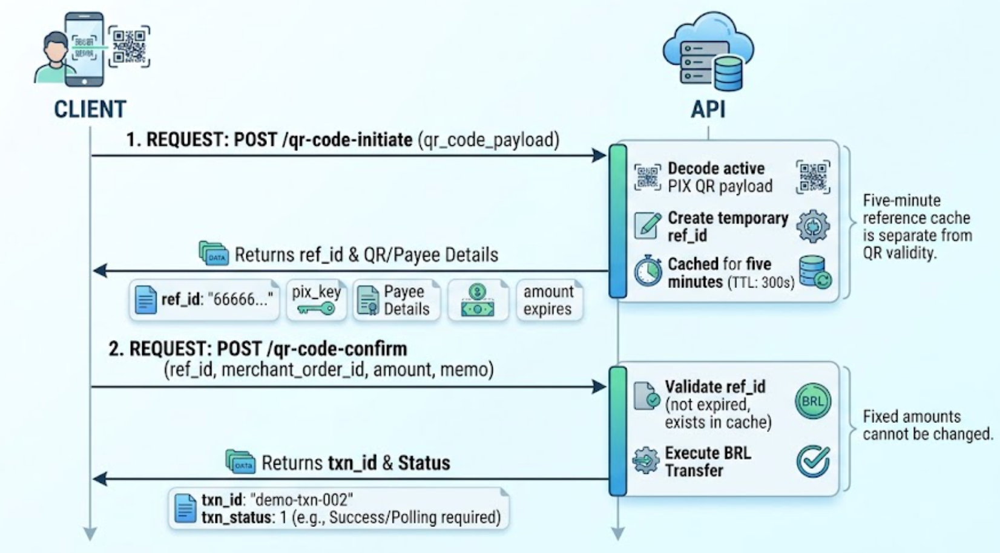

PIX transfer by QR code allows clients to decode dynamic or static QR payloads (Copy and Paste strings), inspect payment and payee details, and confirm the fund transfer in a two-step sequence (Pre-flight Pattern).

## Flow Overview



1. **Initiation (**`qr-code-initiate`**)**: Decodes an active PIX QR code payload, validates its status, and creates a temporary reference (`ref_id`) valid for **5 minutes**.
2. **Confirmation (**`qr-code-confirm`**)**: Consumes the generated `ref_id` to execute the payment in **BRL**.

## Step 1: Initiate QR Code Decoding

`POST /v3/transfers/pix/qr-code-initiate`

Decodes a PIX QR payload (EMV standard / PIX Copy and Paste string) and creates a temporary reference (`ref_id`) bound to the initiating account.

### Request Body

| Field | Type | Required | Description / Validation |
| :-- | :-- | :-- | :-- |
| `qr_code_payload` | String | Yes | Non-empty raw PIX QR code string (EMV standard). |

### Success Response Data (`data`)

| Field | Type | Description |
| :-- | :-- | :-- |
| `ref_id` | String | Temporary pre-flight reference ID (valid in cache for 5 minutes / 300 seconds). |
| `pix_key` | String | Resolved PIX key extracted from the QR code. |
| `pix_key_type` | Number | Numeric enum indicating the type of PIX key. |
| `qr_code_id` | String | Unique identifier of the decoded QR code. |
| `qr_code_type` | Number | Numeric enum representing the QR code category (e.g., Static vs. Dynamic). |
| `amount` | String | Transfer amount defined in the QR code (if fixed). |
| `currency` | String | Transaction currency (fixed to `BRL`). |
| `memo` | String | Description or invoice note embedded in the QR payload. |
| `expires` | Number | Expiration lifetime in seconds passed through from the QR decoder. |
| `settlement_id` | String | Operation settlement identifier. |

> **Important Note on** `expires`**:** The `expires` response field contains an integer in seconds provided by the QR decoder. This is independent of the 5-minute cache TTL of `ref_id`. Do not strictly rely on `expires: 300` as a guarantee of local validity; confirm the QR payload's actual deadline when rendering client-side UI countdowns.

### Example — Initiation

**Request:**

Bash

```text
curl --request POST "${BASE_URL}/v3/transfers/pix/qr-code-initiate" \
  --header "Content-Type: application/json" \
  --header "X-Client-ID: ${CLIENT_ID}" \
  --header "X-Timestamp: ${TIMESTAMP_MS}" \
  --header "X-Nonce: ${NONCE}" \
  --header "X-Content-Hash: ${CONTENT_HASH}" \
  --header "X-Signature: ${SIGNATURE}" \
  --data '{
    "qr_code_payload": "00020101021226DEMO-PIX-QR-PAYLOAD"
  }'
```

**Response:**

JSON

```text
{
  "code": 200,
  "message": "success",
  "data": {
    "ref_id": "66666666-7777-4888-8999-aaaaaaaaaaaa",
    "pix_key": "demo.receiver@example.test",
    "pix_key_type": 3,
    "qr_code_id": "demo-qr-001",
    "expires": 300,
    "amount": "12.34",
    "settlement_id": "demo-settlement-qr-001",
    "qr_code_type": 12,
    "currency": "BRL",
    "memo": "Demo invoice"
  },
  "time": 1767225600000
}
```

## Step 2: Confirm Transfer

`POST /v3/transfers/pix/qr-code-confirm`

Executes payment processing using the valid reference created by the QR initiation endpoint.

### Request Body

| Field | Type | Required | Description / Validation |
| :-- | :-- | :-- | :-- |
| `ref_id` | String | Yes | Reference created in `/qr-code-initiate`. Must exist in the 5-minute QR cache and belong to the operating account. |
| `merchant_order_id` | String | Yes | Partner order ID. **Must start with the UTC date formatted as** `YYMMDD` (accepted date window: current UTC ±1 hour). |
| `amount` | String | Yes | Transfer amount as a positive decimal string with up to 2 decimal places (e.g., `"12.34"`). Must match the initiated amount if the QR had a fixed value. |
| `currency` | String | No | Parameter ignored; payment settlement is processed exclusively in **BRL**. |
| `memo` | String | No | Optional payment note forwarded to payment processing. |

### Success Response Data (`data`)

| Field | Type | Description |
| :-- | :-- | :-- |
| `merchant_order_id` | String | Order identifier provided in the request. |
| `txn_id` | String | Unique transaction ID generated by the API. |
| `txn_status` | Number | Numeric code representing transaction status. |

> **Note:** The synchronous response from the confirmation endpoint may carry a non-final status (`txn_status`). If needed, poll the status endpoint using a fresh nonce.

### Example — Confirmation

**Request:**

Bash

```text
curl --request POST "${BASE_URL}/v3/transfers/pix/qr-code-confirm" \
  --header "Content-Type: application/json" \
  --header "X-Client-ID: ${CLIENT_ID}" \
  --header "X-Timestamp: ${TIMESTAMP_MS}" \
  --header "X-Nonce: ${NONCE}" \
  --header "X-Content-Hash: ${CONTENT_HASH}" \
  --header "X-Signature: ${SIGNATURE}" \
  --data '{
    "ref_id": "66666666-7777-4888-8999-aaaaaaaaaaaa",
    "merchant_order_id": "<CURRENT_UTC_YYMMDD>-demo-qr-001",
    "amount": "12.34",
    "currency": "BRL",
    "memo": "Demo QR payment"
  }'
```

**Response:**

JSON

```text
{
  "code": 200,
  "message": "success",
  "data": {
    "merchant_order_id": "<CURRENT_UTC_YYMMDD>-demo-qr-001",
    "txn_id": "demo-pix-txn-002",
    "txn_status": 1
  },
  "time": 1767225600000
}
```

## Authentication and Headers

All requests require **HMAC-SHA256** authentication. Header requirements depend on the credential type being used:

| Header | Type | Required | Description |
| :-- | :-- | :-- | :-- |
| `Content-Type` | String | Yes | Must be `application/json`. |
| `X-Client-ID` | String | Yes | API client credential identifier. |
| `X-Timestamp` | String | Yes | Unix timestamp in milliseconds. |
| `X-Nonce` | String | Yes | Unique request identifier (prevents replay attacks). |
| `X-Content-Hash` | String | Yes | SHA256 hash of the request body. |
| `X-Signature` | String | Yes | HMAC-SHA256 signature of the canonical request. |
| `X-ISPB` | String | Conditional | Required for `USER` credentials. If sent with an `ACCOUNT` credential, it must match its bound account. |
| `X-Account-Number` | String | Conditional | Required for `USER` credentials. If sent with an `ACCOUNT` credential, it must match its bound account. |

> **Credential Notes:**
>
> - **ACCOUNT**: Credentials bound directly to a single account. Omit `X-ISPB` and `X-Account-Number`.
> - **USER**: Requires both `X-ISPB` and `X-Account-Number` present in headers and included in the canonical header set prior to calculating `X-Signature`.
> - **PLATFORM**: **Not accepted** on these endpoints.

## Error Matrix

Endpoint-specific error codes for the PIX QR code transfer flow, in addition to standard signature and timestamp verification errors:

| Error Code | Endpoint | Description / Cause | Recommended Action |
| :-- | :-- | :-- | :-- |
| `4000` | Both | Missing required field (`qr_code_payload`, `ref_id`, `merchant_order_id`, `amount`). | Verify that all mandatory payload fields are present in the JSON body. |
| `4001015` | Initiate | Expired or malformed QR code payload. | Request a new or updated QR code payload from the payee. |
| `4001096` | Initiate | Inactive or deleted PIX key referenced by the QR code. | Ask the payee to verify their PIX key status in their banking app. |
| `501` / `500` | Both | Downstream QR decoder or internal service failure. | Retry the request. Contact support if the issue persists. |
| `4002` | Confirm | Invalid `amount` format or invalid `merchant_order_id` format. | Format `amount` as a 2-decimal string (e.g., `"10.00"`) and start `merchant_order_id` with `YYMMDD`. |
| `400` | Confirm | Stale UTC date prefix on `merchant_order_id`. | Adjust the `YYMMDD` prefix to overlap current UTC time within ±1 hour. |
| `400` | Confirm | Attempted to change amount on a **fixed-amount** QR code. | Use the exact `amount` returned during the `/qr-code-initiate` step. |
| `4003012` | Confirm | `ref_id` missing, expired (> 5 minutes), or invalid. | Restart the flow by calling `/qr-code-initiate` to obtain a fresh `ref_id`. |
| `4004003` | Confirm | `ref_id` belongs to another account. | Ensure the operating payer account matches the account that initiated the QR decode. |
| `4003014` | Confirm | Payment processing failure (e.g., insufficient funds). | Check account balance or inspect mapped provider failure reasons. |

## Business Rules & Best Practices

- **Reference Lifetime (**`ref_id`**)**: The `ref_id` for QR transfers carries a cache time-to-live (TTL) of **5 minutes (300 seconds)**, compared to 60 seconds for key transfers.
- **Fixed vs. Variable Amount QR Codes**:
  - **Fixed-Amount QR**: The `amount` submitted in `/qr-code-confirm` **must match** the `amount` returned in `/qr-code-initiate`. Any modification will trigger an HTTP `400` error.
  - **Variable/Open QR**: If no amount is embedded in the initial QR payload, the client must specify the transfer amount during the `/qr-code-confirm` request.
- **Single-Use Reference**: The `ref_id` is automatically invalidated and deleted upon successful payment confirmation. If an upstream network error occurs during confirmation, the reference is retained within its 5-minute window for retry attempts.
- `merchant_order_id `**Format**: Order identifiers must begin with a UTC date prefix formatted as `YYMMDD` (e.g., `261101-qr-order-001`). Requests are rejected if the date string drifts beyond UTC ±1 hour.
