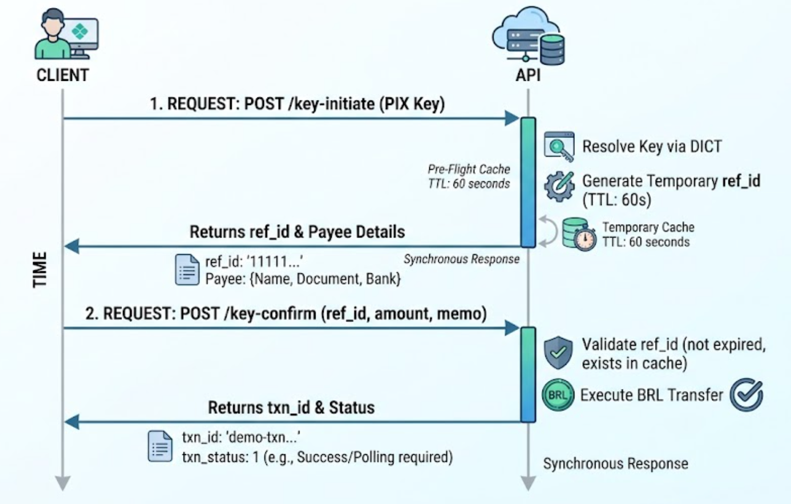

PIX transfer by key allows clients to resolve payee details and confirm the fund transfer in a two-step sequence (Pre-flight Pattern).

## Flow Overview



1. **Initiation (**`key-initiate`**)**: Resolves the PIX key, validates payee information, and creates a temporary reference (`ref_id`) valid for **1 minute**.
2. **Confirmation (**`key-confirm`**)**: Consumes the generated `ref_id` to execute the payment in **BRL**.

## Authentication and Headers

All requests require **HMAC-SHA256** authentication. Header requirements depend on the credential type being used:

| **Header** | **Type** | **Required** | **Description** |
| :-- | :-- | :-- | :-- |
| `Content-Type` | String | Yes | Must be `application/json`. |
| `X-Client-ID` | String | Yes | API client credential identifier. |
| `X-Timestamp` | String | Yes | Unix timestamp in milliseconds. |
| `X-Nonce` | String | Yes | Unique request identifier (prevents replay attacks). |
| `X-Content-Hash` | String | Yes | SHA256 hash of the request body. |
| `X-Signature` | String | Yes | HMAC-SHA256 signature of the canonical request. |
| `X-ISPB` | String | Conditional | Required for `USER` credentials. If sent with an `ACCOUNT` credential, it must match its bound account. |
| `X-Account-Number` | String | Conditional | Required for `USER` credentials. If sent with an `ACCOUNT` credential, it must match its bound account. |

> **Credential Notes:**
>
> - **ACCOUNT**: Credentials bound directly to a single account. Omit `X-ISPB` and `X-Account-Number`.
> - **USER**: Requires both `X-ISPB` and `X-Account-Number` present in headers and included in the canonical header set prior to calculating `X-Signature`.
> - **PLATFORM**: **Not accepted** on these endpoints.

## Step 1: Initiate Key Resolution

`POST /v3/transfers/pix/key-initiate`

Resolves a PIX key against DICT and creates a temporary reference (`ref_id`) bound to the initiating account.

### Request Body

| **Field** | **Type** | **Required** | **Description / Validation** |
| :-- | :-- | :-- | :-- |
| `pix_key` | String | Yes | Target PIX key (CPF, CNPJ, Email, Phone, or EVP). The service automatically trims and normalizes input data. |

### Success Response Data (`data`)

| **Field** | **Type** | **Description** |
| :-- | :-- | :-- |
| `ref_id` | String | Temporary pre-flight reference ID (valid for 60 seconds). |
| `settlement_id` | String | Operation settlement identifier. |
| `payee` | Object | Object containing resolved payee details. |
| `payee.name` | String | Full legal name of the payee. |
| `payee.document_id` | String | Payee CPF/CNPJ (may be masked based on merchant configuration). |
| `payee.document_type` | Number | Numeric enum representing the document type. |
| `payee.bank_account` | String | Payee bank account number. |
| `payee.bank_account_type` | Number | Numeric enum representing bank account type (e.g., checking, savings). |
| `payee.bank_branch` | String | Bank branch number. |
| `payee.bank_code` | String | Payee institution COMPE/ISPB code. |
| `payee.bank_name` | String | Payee bank institution name. |

```text
{
  "code": 200,
  "message": "success",
  "data": {
    "ref_id": "11111111-2222-4333-8444-555555555555",
    "payee": {
      "name": "Demo Receiver",
      "document_id": "***-demo",
      "document_type": 1,
      "bank_account": "DEMO-RECEIVER-01",
      "bank_account_type": 1,
      "bank_branch": "0001",
      "bank_code": "00000000",
      "bank_name": "Demo Bank"
    },
    "settlement_id": "demo-settlement-key-001"
  },
  "time": 1767225600000
}
```

### Curl Example — Initiation

**Request:**

Bash

```text
curl --request POST "${BASE_URL}/v3/transfers/pix/key-initiate" \
  --header "Content-Type: application/json" \
  --header "X-Client-ID: ${CLIENT_ID}" \
  --header "X-Timestamp: ${TIMESTAMP_MS}" \
  --header "X-Nonce: ${NONCE}" \
  --header "X-Content-Hash: ${CONTENT_HASH}" \
  --header "X-Signature: ${SIGNATURE}" \
  --data '{
    "pix_key": "demo.receiver@example.test"
  }'
```

## Step 2: Confirm Transfer

`POST /v3/transfers/pix/key-confirm`

Executes the PIX transfer by consuming the `ref_id` created during initiation.

### Request Body

| **Field** | **Type** | **Required** | **Description / Validation** |
| :-- | :-- | :-- | :-- |
| `ref_id` | String | Yes | Reference created in `/key-initiate`. Must exist in the 1-minute preflight cache and belong to the operating account. |
| `merchant_order_id` | String | Yes | Partner order ID. **Must start with the UTC date formatted as** `YYMMDD` (accepted date window: current UTC ±1 hour). |
| `amount` | String | Yes | Transfer amount. Positive decimal string with up to two decimal places (e.g., `"12.34"`). |
| `memo` | String | No | Message or description forwarded to payment processing. |

### Success Response Data (`data`)

| **Field** | **Type** | **Description** |
| :-- | :-- | :-- |
| `merchant_order_id` | String | Order identifier provided in the request. |
| `txn_id` | String | Unique transaction ID generated by the API. |
| `txn_status` | Number | Numeric code representing transation status. |

> **Note:** The synchronous response from the confirmation endpoint may carry a non-final status (`txn_status`). If needed, poll the status endpoint using a fresh nonce.

```text
{
  "code": 200,
  "message": "success",
  "data": {
    "merchant_order_id": "261031-demo-key-001",
    "txn_id": "demo-pix-txn-001",
    "txn_status": 1
  },
  "time": 1767225600000
}
```

### Curl Example — Confirmation

**Request:**

Bash

```text
curl --request POST "${BASE_URL}/v3/transfers/pix/key-confirm" \
  --header "Content-Type: application/json" \
  --header "X-Client-ID: ${CLIENT_ID}" \
  --header "X-Timestamp: ${TIMESTAMP_MS}" \
  --header "X-Nonce: ${NONCE}" \
  --header "X-Content-Hash: ${CONTENT_HASH}" \
  --header "X-Signature: ${SIGNATURE}" \
  --data '{
    "ref_id": "11111111-2222-4333-8444-555555555555",
    "merchant_order_id": "261031-demo-key-001",
    "amount": "12.34",
    "memo": "Demo PIX payment"
  }'
```

## Authentication and Headers

All requests require **HMAC-SHA256** authentication. Header requirements depend on the credential type being used:

| **Header** | **Type** | **Required** | **Description** |
| :-- | :-- | :-- | :-- |
| `Content-Type` | String | Yes | Must be `application/json`. |
| `X-Client-ID` | String | Yes | API client credential identifier. |
| `X-Timestamp` | String | Yes | Unix timestamp in milliseconds. |
| `X-Nonce` | String | Yes | Unique request identifier (prevents replay attacks). |
| `X-Content-Hash` | String | Yes | SHA256 hash of the request body. |
| `X-Signature` | String | Yes | HMAC-SHA256 signature of the canonical request. |
| `X-ISPB` | String | Conditional | Required for `USER` credentials. If sent with an `ACCOUNT` credential, it must match its bound account. |
| `X-Account-Number` | String | Conditional | Required for `USER` credentials. If sent with an `ACCOUNT` credential, it must match its bound account. |

> **Credential Notes:**
>
> - **ACCOUNT**: Credentials bound directly to a single account. Omit `X-ISPB` and `X-Account-Number`.
> - **USER**: Requires both `X-ISPB` and `X-Account-Number` present in headers and included in the canonical header set prior to calculating `X-Signature`.
> - **PLATFORM**: **Not accepted** on these endpoints.

## Error Matrix

Endpoint-specific error codes for the PIX key transfer flow, in addition to standard signature and timestamp verification errors:

| **Error Code** | **Endpoint** | **Description / Cause** | **Recommended Action** |
| :-- | :-- | :-- | :-- |
| `4000` | Both | Missing required field (`pix_key`, `ref_id`, `merchant_order_id`, `amount`). | Verify that all mandatory payload fields are present in the JSON body. |
| `400` / `4001001` | Initiate | Invalid PIX key format or data. | Check key formatting (CPF, CNPJ, email, phone with DDD, or EVP UUID). |
| `4001096` | Initiate | Inactive or deleted key in DICT. | Request the recipient to verify their key status in their banking app. |
| `4003008` | Initiate | Missing account context. | Ensure `X-ISPB` and `X-Account-Number` are supplied when using `USER` credentials. |
| `501` | Initiate | Downstream DICT lookup RPC failure. | Retry the lookup request. |
| `500` | Both | Cache error or internal server failure. | Retry the request. Contact support if the error persists. |
| `4002` | Confirm | Invalid `amount` or `merchant_order_id` format. | Format `amount` as a 2-decimal string (e.g., `"10.00"`) and start `merchant_order_id` with `YYMMDD`. |
| `400` | Confirm | Stale or invalid date prefix on `merchant_order_id`. | Adjust the `YYMMDD` prefix to overlap current UTC time within ±1 hour. |
| `4003012` | Confirm | `ref_id` missing, expired (> 60s), or invalid. | Restart the flow by calling `/key-initiate` to obtain a fresh `ref_id`. |
| `4004003` | Confirm | `ref_id` belongs to another account. | Ensure the operating payer account matches the account that initiated the lookup. |
| `4003014` | Confirm | Payment processing failure (e.g., insufficient funds). | Check account balance or inspect mapped provider failure reasons. |

## Business Rules & Best Practices

- **Reference Lifetime (**`ref_id`**)**: The `ref_id` carries a time-to-live (TTL) of **60 seconds**. It represents preflight lookup state and does **not** function as an idempotency key.
- **Single-Use Reference**: The `ref_id` is purged immediately upon a successful payment response. It cannot be reused for subsequent confirmation attempts.
- **Currency**: Transfer currency is permanently set to **BRL**.
- `merchant_order_id `**Format**: Order identifiers must begin with a UTC date prefix formatted as `YYMMDD` (e.g., `261031-order-001`). Requests are rejected if the date string drifts beyond UTC ±1 hour.
