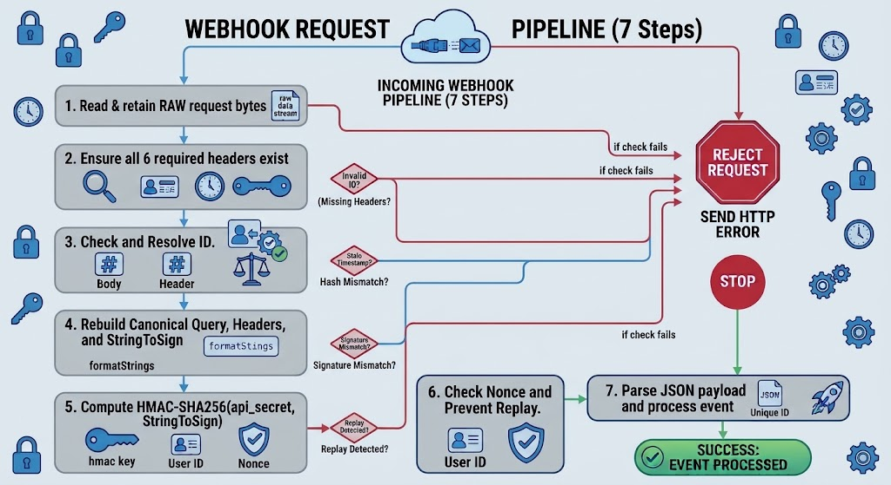

All webhook payloads sent by Pagsmile are signed using **HMAC-SHA256**. Validating the request signature ensures data authenticity, integrity, and protection against unauthorized requests.

> **Security Requirement:** Always verify the signature against the exact raw HTTP request body _before_ parsing the JSON body. Your `API Secret` is used locally to compute the signature and is never transmitted in the request.

## Required Request Headers

Every incoming webhook request includes six headers essential for authenticity verification:

<table>
  <colgroup>
    <col width="140" />
    <col width="556" />
  </colgroup>
  <thead>
    <tr>
      <td>**Header**</td>
      <td>**Description**</td>
    </tr>
  </thead>
  <tbody>
    <tr>
      <td>`Content-Type`</td>
      <td>Exact request content-type string used during signature generation.</td>
    </tr>
    <tr>
      <td>`X-Client-ID`</td>
      <td>API Key identifying the signing credential.</td>
    </tr>
    <tr>
      <td>`X-Timestamp`</td>
      <td>Request execution time in Unix milliseconds.</td>
    </tr>
    <tr>
      <td>`X-Nonce`</td>
      <td>32-character lowercase hexadecimal random string.</td>
    </tr>
    <tr>
      <td>`X-Content-Hash`</td>
      <td>Lowercase SHA-256 hex digest computed over the raw payload body.</td>
    </tr>
    <tr>
      <td>`X-Signature`</td>
      <td>Lowercase HMAC-SHA256 hex signature to compare against.</td>
    </tr>
  </tbody>
</table>

> 📌 **Note:** `X-Signature` is not included in canonical headers; it is the target value used for final verification.

## Signature Construction (`StringToSign`)

To calculate the expected signature, construct the `StringToSign` string by concatenating the seven components below with a single line feed (`\n`). **Do not append a trailing line feed at the end.**

Plaintext

```text highlight={2-3}
StringToSign = 
  HTTP_METHOD + "\n" +
  CANONICAL_PATH + "\n" +
  CANONICAL_QUERY + "\n" +
  CANONICAL_HEADERS + "\n" +
  CONTENT_HASH + "\n" +
  TIMESTAMP + "\n" +
  NONCE
```

### Canonicalization Rules

1. **HTTP Method:** Convert to uppercase string (e.g., `POST`).
2. **Canonical Path:**
   - Include path only (exclude scheme, host, query, and fragment).
   - Normalize empty paths to `/`.
   - Preserve trailing slashes.
   - _Best Practice:_ Use a simple ASCII path (e.g., `/webhooks/pagsmile`) to prevent escaping mismatches across event families.
3. **Canonical Query:** Lexically sort query parameters by name, format as `name=value` (using `+` for spaces), and join with `&`. If no query exists, use an empty line.
4. **Canonical Headers:** Formatted in lexical order for exact header names: `content-type`, `x-client-id`, `x-content-hash`, `x-nonce`, `x-timestamp`. Trim whitespace and format as `lowercase-name:trimmed-value`.
5. **Content Hash:** SHA-256 computed over exact raw network bytes. **Do not** parse and re-serialize JSON before hashing.

## Verification Pipeline (10-Step Execution Flow)

Follow this strict step-by-step pipeline inside your application middleware:



> 🛡️ **Timing-Attack Protection:** Always compare your calculated signature with `X-Signature` using a constant-time comparison function (e.g., `crypto.timingSafeEqual` in Node.js or `hmac.equal` in Python) to prevent side-channel timing attacks.
